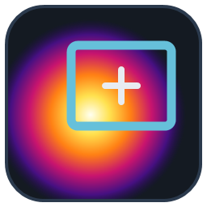
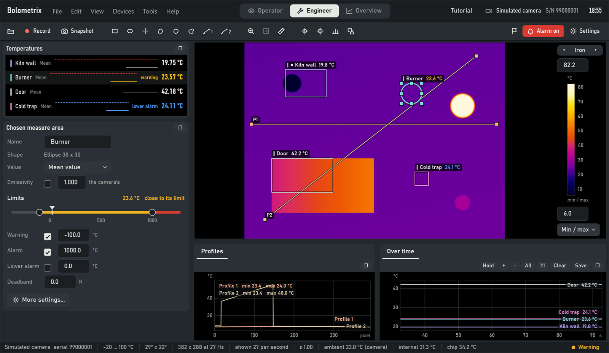
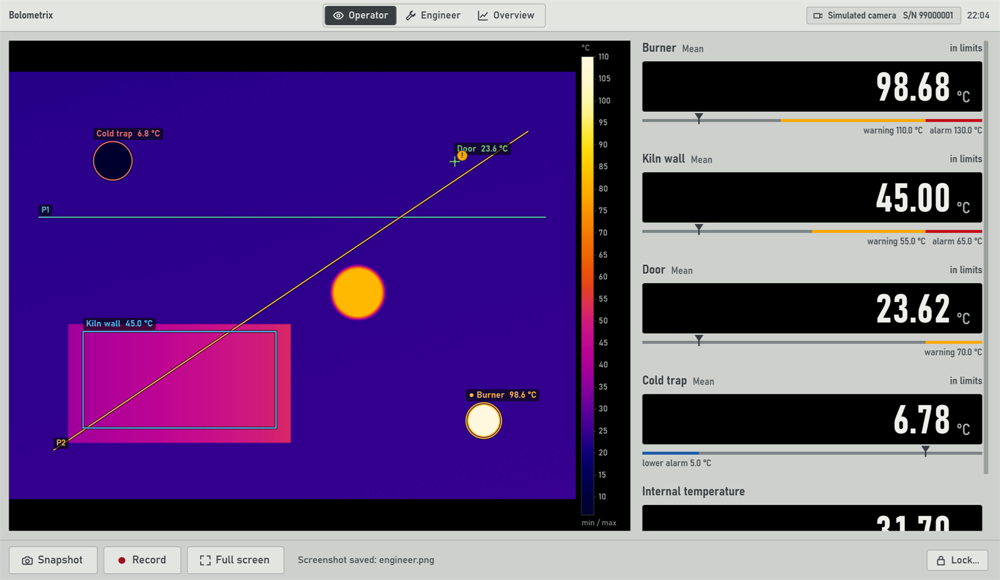
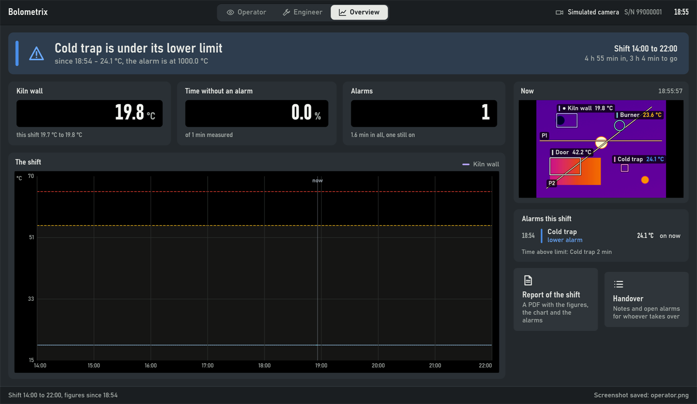
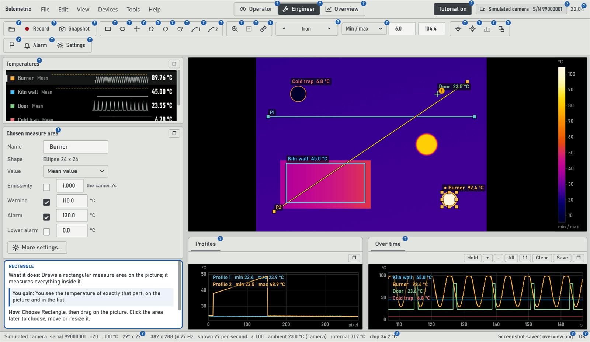
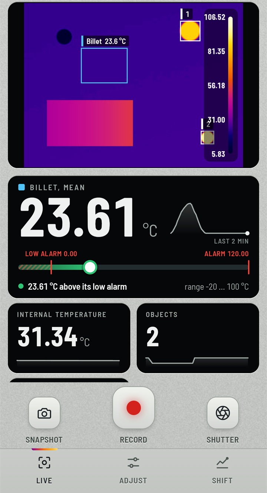

  

<h1 align="center">Bolometrix</h1>

  <b>Temperature measurement and analysis for Optris infrared cameras</b> 
  Free for Windows 10 and 11 &middot; without a window also for Linux

  
  

  
  
  
  

  

Bolometrix turns an Optris infrared camera into a complete thermal measurement station: on the line, in the lab, or on a PC without a screen. Made by Derek Holzapfel. **Not an Optris product** — not made, sold or supported by Optris. Its temperatures are worked out by the Optris SDK, which comes with it.

| Measure | Record | Connect |
|---|---|---|
| Measure areas of any shape, hot and cold spots, profiles, calculated objects and objects found by temperature, each value with its own alarm, uncertainty and history. | Radiometric recordings you can measure again later, snapshots, line scans of moving products, each shift's record and report, and an alarm journal. | Modbus TCP, OPC UA, MQTT, e-mail, a live web page, a video stream, an AI link and an Android app, each off until you switch it on. |

<table>
  <tr>
    <td width="50%" valign="top"> <b>Operator view</b>: the readings at a glance, in their alarm colours.</td>
    <td width="50%" valign="top"> <b>Overview</b>: the shift at a glance, with its report and handover.</td>
  </tr>
  <tr>
    <td valign="top"> <b>Tutorial mode</b>: a card for every tool, and 18 lessons on your own live picture.</td>
    <td valign="top" align="center"> <b>Android app</b>: the live picture, readings and alarms on the plant floor.</td>
  </tr>
</table>

## Why you can trust its numbers

- **Tried on a real camera.** Version 0.20.1 was run on an Optris Xi 400 by its own test scripts.
- **Every calculation checked from outside.** Two validators who never saw the program's code worked out the expected values from the user's guide and published standards, froze them, and then ran the released program: 4,940 results, none of them a wrong temperature, statistic or verdict.
- **Every connection tested with independent clients**: OPC UA, Modbus TCP, MQTT and the AI link's protocol, and for two hours all at once under load, with malformed input in between.
- **Installers tried on a fresh Windows**: a clean install, an upgrade, removing it, and the quiet `.msi`.
- **Plain about its limits.** Each release says what was tried, what was not, and what the program cannot do.

## Get started

1. **Download** `Bolometrix-<version>-Setup.exe` from the [latest release][latest].
2. **Install.** The files carry no digital signature, so Windows warns the first time: choose **More info → Run anyway**, then **Yes** at the administrator question. IT departments can use the `.msi` instead (see `For-IT-departments.txt`).
3. **Plug in the camera** and open **Bolometrix** from the Start menu. A camera that is there when the program starts is connected by itself; one plugged in later is chosen in the camera list.

To check a download, compare `Get-FileHash -Algorithm SHA256 Bolometrix-<version>-Setup.exe` with the line in `SHA256SUMS.txt`.

<b>Everything it does</b>

- **Live measurement**: measure areas (rectangle, ellipse, point, polygon, freehand, profiles), hot and cold spot tracking, calculated objects, per-area emissivity and emissivity regions, objects found by temperature, and lengths and sizes in millimetres from the distance and the field of view.
- **Values you can trust**: the uncertainty of each value from Optris's stated accuracy, user calibration at several points (every corrected value marked "corr."), a verification log of readings against a reference, and the camera's health at a glance.
- **Alarms**: upper and lower limits with pre-alarms, shown in words and colour, that can set off a snapshot, a recording or a process-interface output. Each value keeps its own alarm; an alarm can be shelved for a while with a reason, acknowledging records who and why, and an alarm journal keeps them all. "Limit in about 12 min" when a value heads for its limit, and a rate-of-change object in K per minute.
- **Left running**: a watchdog that starts the program again when its window stops answering (only when that costs the line nothing), a health page for the whole chain, a guard for the recordings' disk, and a grey "no new picture" when the camera stops sending.
- **The shift**: each shift's record and report, saved and e-mailed at its end; a handover with notes, open items and a sign-off; each shift's phones, and an e-mail for an alarm nobody acknowledges.
- **Parts**: a good part per recipe, and a record per part with each area's difference and a verdict, with an output and Modbus registers for the PLC.
- **One phone at a time**: a phone takes control before it changes anything, the PC can always take it back, and the status line shows who is watching.
- **Three views**: Operator (watch the process), Engineer (set it up) and Overview (the shift at a glance, with a one-page PDF shift report).
- **Recording and snapshots**: radiometric recordings you can measure again later, plain-video recordings, and radiometric TIFF, CSV and image snapshots, with a watermark if you like.
- **Exports, reports and batch work**: pictures, diagrams and recordings to Excel, MATLAB and HDF5; inspection reports from snapshots as PDF or Word; one setting applied to many snapshots at once.
- **Line scanning**: a picture of a moving belt, sheet or strip, built line by line.
- **Merged pictures**: several cameras side by side, shown and measured as one picture.
- **Dual-range test**: two cameras in different ranges joined into one temperature curve; each test saved with its data, a plot and full metadata.
- **Interfaces**: the Optris process interface, remote commands over COM and TCP, a live web page with a QR code (it also offers the Android app), a shared live picture, and a phone link.
- **Connections to other systems**: Modbus TCP and OPC UA servers for PLCs and SCADA, MQTT, e-mail (or text message) on alarms, an RTSP video stream, an AI link (MCP) for assistants, and one overview of several PCs. Each is off until you switch it on, listens only on the PC itself until you choose the network, and changes nothing unless you allow it.
- **The plant**: a long history (a year of values), process statistics (Pp and Ppk, and Cp and Cpk within the shift), recipes with lot numbers, user roles with an audit trail, and ready starts for common jobs.
- **Tutorial mode**: a card for every tool (what it does, what you gain, how) and 18 short lessons that walk you through tasks on your own live picture, in a coach beside the picture that never covers it.
- **Reach**: the window in English, German or Spanish; updates and error reports when you switch them on; network cameras found and set up with a guide; autofocus on your word.
- **Without a window**: Bolometrix for a server or a PC without a screen, on Windows and on Linux (x64 and arm64, with Optris's Linux SDK).

<b>Requirements</b>

- Windows 10 or 11, 64-bit.
- An Optris infrared camera (tried with the Xi 400 and the Xi 1M).
- Nothing else: the parts of the Optris SDK the camera needs come with Bolometrix.
- Only for Bolometrix without a window: Microsoft's .NET 10 runtime (or newer); on Linux also Optris's SDK package for the system (Ubuntu 24.04 x64 or Debian 12 arm64). The Linux builds are `Bolometrix-<version>-linux-x64.zip` and `-linux-arm64.zip`; they are built but not yet tried on Linux.

<b>Network and privacy</b>

As it comes, Bolometrix sends nothing over the internet by itself, with one exception: when a camera needs calibration files that are not on the PC, the Optris SDK downloads them from Optris (this can be switched off on the page Camera). When the PC lacks it, `Setup.exe` fetches Microsoft's Visual C++ runtime from Microsoft.

Every network function is off until you switch it on, and one that listens (web page, remote commands, Modbus TCP, OPC UA, the video stream) stays on the PC itself until you choose the network. What you switch on sends only to what you enter: updates to GitHub (at most once a day), MQTT to your broker, e-mail to your mail server, the overview of other PCs to their pages. `For-IT-departments.txt` lists every port.

<b>Documents</b>

- [User's guide (PDF)](https://github.com/derekownsall/bolometrix/releases/latest/download/Users-guide.pdf): step by step, with pictures (also under Help in the program).
- [For IT departments](https://github.com/derekownsall/bolometrix/releases/latest/download/For-IT-departments.txt): quiet installs, folders, every port.
- [Terms of use](https://github.com/derekownsall/bolometrix/releases/latest/download/Terms-of-use.txt): also under Help → Terms of use.
- [Notices](https://github.com/derekownsall/bolometrix/releases/latest/download/Notices.txt): the parts made by others that Bolometrix includes, and their licenses.
- What each version brought: the [releases page][releases], and `CHANGELOG.txt` beside the installed program.

## Support

Questions and problems: **derekholzapfel@gmail.com**. In the program, **Help → Report a problem** opens the log folder and says what to send.

---

Bolometrix is free to use and comes as it is, with no warranty. Its alarms and outputs help you watch a process; they are not a safety system. Copyright (c) 2026 Derek Holzapfel. All rights reserved. Optris is a registered trademark of Optris GmbH & Co. KG; Xi is a product name of Optris. QR Code is a registered trademark of DENSO WAVE INCORPORATED. Microsoft, Windows, Excel, Word and .NET are trademarks of the Microsoft group of companies. MATLAB is a registered trademark of The MathWorks, Inc. HDF5 is a trademark of The HDF Group. Modbus is a registered trademark of Schneider Electric USA, Inc. OPC UA is a trademark of the OPC Foundation. Linux is the registered trademark of Linus Torvalds in the U.S. and other countries. Ubuntu is a registered trademark of Canonical Ltd. Debian is a registered trademark of Software in the Public Interest, Inc. Android is a trademark of Google LLC. They are named here only to say what Bolometrix works with.

[latest]: https://github.com/derekownsall/bolometrix/releases/latest
[releases]: https://github.com/derekownsall/bolometrix/releases
