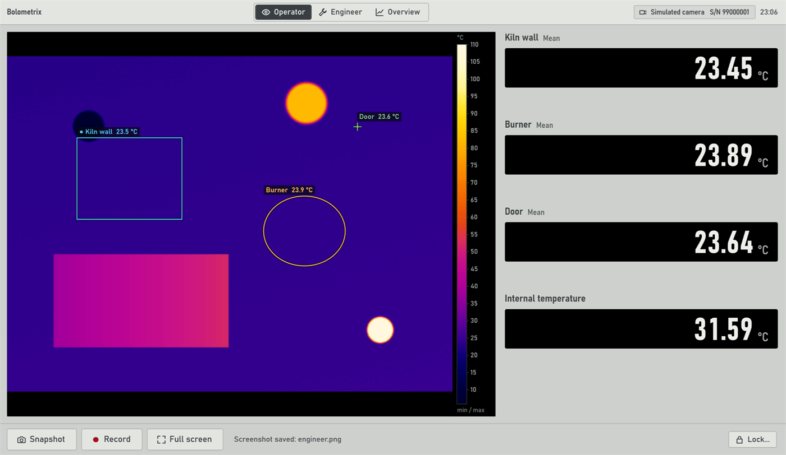

# Bolometrix

**Temperature measurement and analysis for Optris infrared cameras, on Windows.**

Bolometrix turns an Optris infrared camera into a full thermal measurement station: a live
thermal picture with measure areas and alarms, recordings and snapshots, line scanning of moving
objects, several cameras joined into one picture, and a dual-range test that joins two cameras
into one temperature curve. It brings the functions of Optris's PIX Connect to the Optris Thermal
Camera SDK, and follows the SDK as Optris updates it.

Made by Derek Holzapfel. **Not an Optris product** — not made, sold or supported by Optris. Its
temperatures are computed by the Optris Thermal Camera SDK, which ships with it.



## What it does

- **Live measurement** — measure areas (rectangle, ellipse, point, polygon, profiles), hot and
  cold spot tracking, calculated objects, and per-area emissivity.
- **Alarms** — upper and lower limits with pre-alarms, shown in words and colour, that can set
  off a snapshot, a recording, or a process-interface output.
- **Three views** — Operator (watch the process), Engineer (set it up), and Overview (the shift
  at a glance, with a one-page PDF shift report).
- **Recording & snapshots** — radiometric recordings you can re-measure later, plain-video
  recordings, and radiometric TIFF / CSV / image snapshots.
- **Line scanning** — build a picture of a moving belt, sheet, or strip, line by line.
- **Merged pictures** — several cameras side by side, shown and measured as one picture.
- **Dual-range test** — two cameras in different ranges joined into one temperature curve; each
  test is saved with its data, a plot, and full metadata.
- **Interfaces** — the Optris process interface, PIX Connect-compatible remote commands over COM
  and TCP, a live web page with a QR code, a shared live picture, and a phone link (the phone app
  is still being built).

## Requirements

- Windows 10 or 11, 64-bit
- An Optris infrared camera (tested with the Xi 400)
- Nothing else — the parts of the Optris SDK the camera needs ship with Bolometrix. You do not
  install the Optris SDK or PIX Connect.

## Install

1. Download `Bolometrix-<version>-Setup.exe` from the [Releases page][releases].
2. The files are unsigned, so Windows warns the first time. Choose **More info → Run anyway**,
   then **Yes** at the administrator prompt. IT departments can deploy the `.msi` instead — see
   `For IT departments.txt`.
3. (Optional) Check a download against `SHA256SUMS.txt`:
   ```powershell
   Get-FileHash -Algorithm SHA256 Bolometrix-<version>-Setup.exe
   ```

Then plug in the camera and open **Bolometrix** from the Start menu: a camera that is there when
the program starts is connected by itself. A camera plugged in later: choose it in the camera list
and click **Connect**.

## Network

Bolometrix sends nothing over the internet by itself, with one exception: when a camera needs
calibration files that are not on the PC, the Optris SDK downloads them from Optris (this can be
switched off on the page Camera). When the PC lacks it, `Setup.exe` fetches
Microsoft's Visual C++ runtime from Microsoft.

## Documentation

- **User's guide** (`User's guide.pdf`) — step-by-step, with pictures.
- **Changelog** (`CHANGELOG.txt`) — what each version added.
- **Terms of use** (`Terms of use.txt`) — also under Help → Terms of use.
- **Notices** (`Notices.txt`) — the parts made by others that Bolometrix includes, and their
  licenses.

## Support

Questions and problems: **derekholzapfel@gmail.com**. In the program, **Help → Report a problem**
opens the log folder and says what to send.

---

Bolometrix is free to use and comes as it is, with no warranty. Its alarms and outputs help you
watch a process; they are not a safety system.

Copyright (c) 2026 Derek Holzapfel. All rights reserved.
Optris is a registered trademark of Optris GmbH & Co. KG; PIX Connect and Xi are product names of
Optris. QR Code is a registered trademark of DENSO WAVE INCORPORATED. Microsoft, Windows and .NET
are trademarks of the Microsoft group of companies. They are named here only to say what
Bolometrix works with.

[releases]: https://github.com/derekownsall/bolometrix/releases